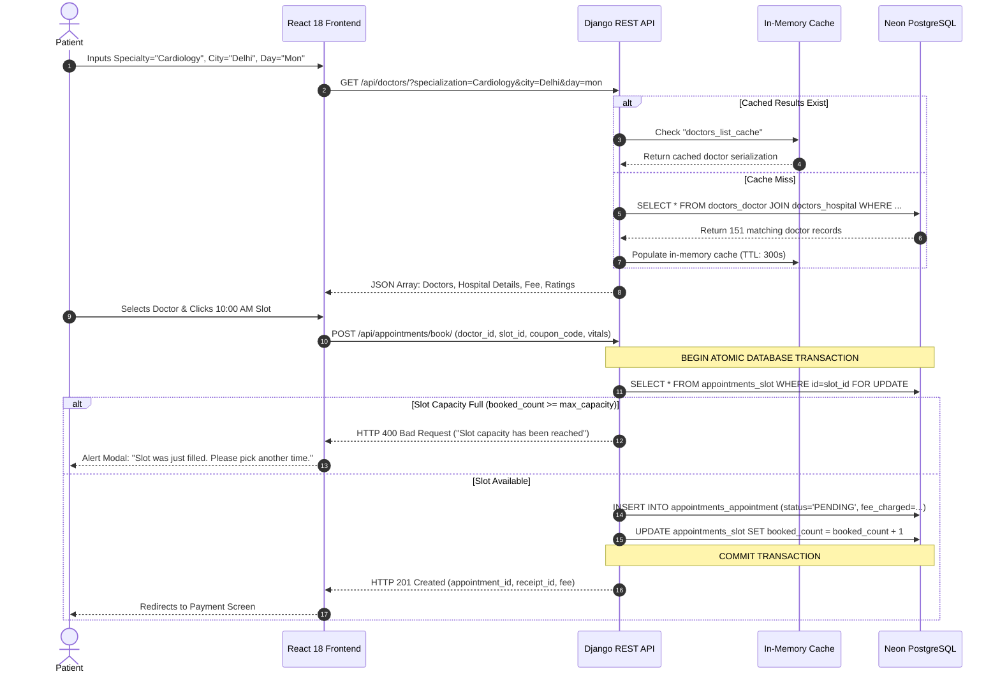
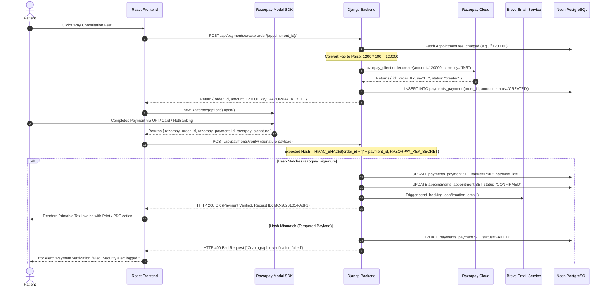
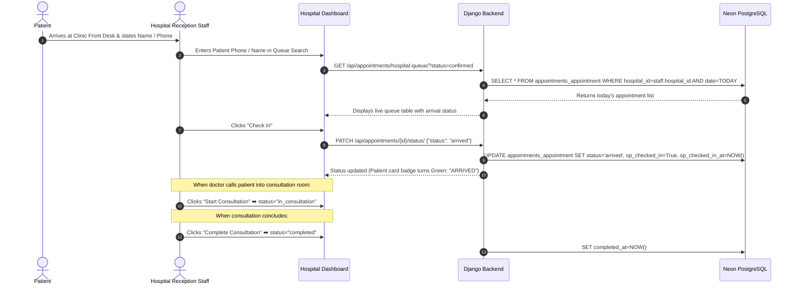
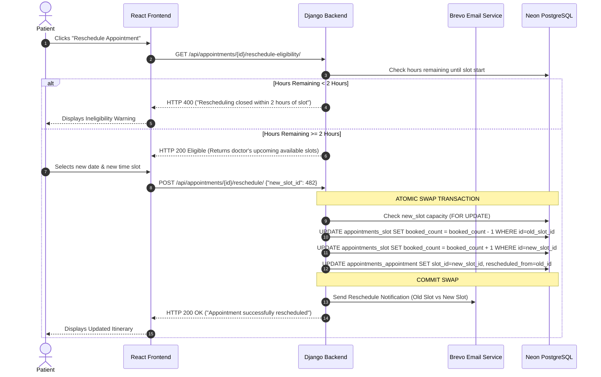
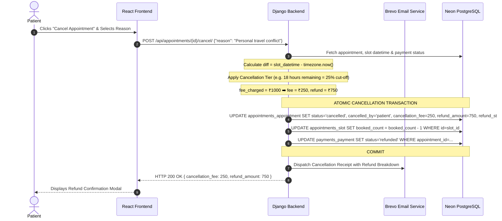
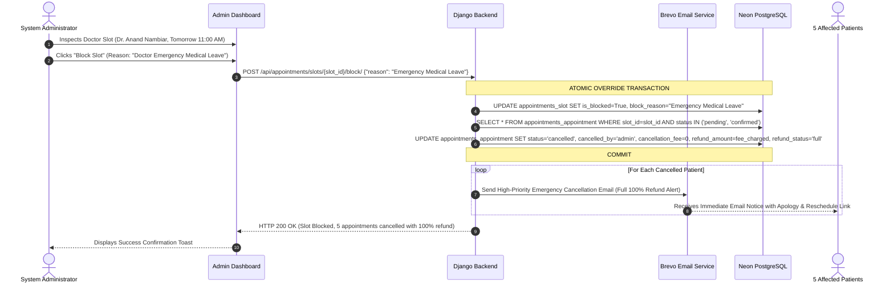
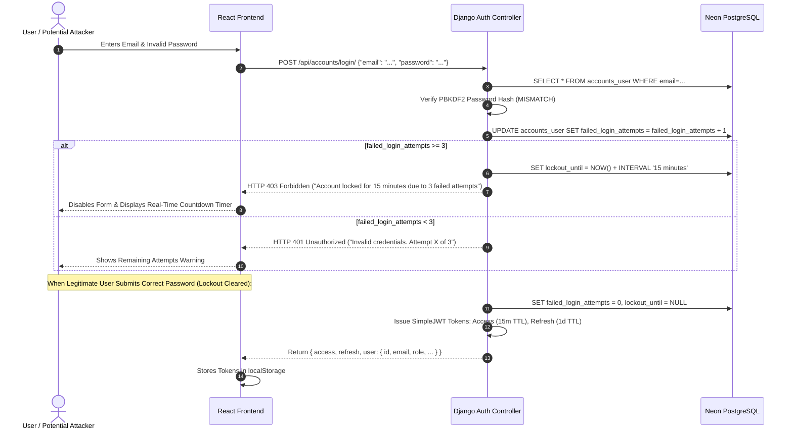

# 🏥 CareConnect — Exhaustive System Architecture, Workflows, Challenges & Risk Analysis Handbook

> **Project Identity**: CareConnect Enterprise Doctor Appointment & Hospital Management System  
> **Repository**: [vengalreddy422 / Doctor](https://github.com/vengalreddy422/Doctor)  
> **Live Production Endpoints**:
> - **Frontend SPA (Vercel Edge CDN)**: Production Client Application
> - **Backend REST API (Render Web Service)**: `https://doctor-mnrl.onrender.com/api/`
> - **Database Tier (Neon Cloud Serverless)**: PostgreSQL 16 with SSL Connection Pooling (`ep-wandering-wave-...aws.neon.tech`)

---

## 📑 Comprehensive Table of Contents

1. **System Overview & Architectural Blueprint**
2. **Detailed Role-Based Functional Capabilities (4 Roles)**
3. **End-to-End System Workflows & Mermaid Diagrams**
   - Workflow 1: Dynamic Doctor Search, Smart Slot Allocation & Concurrency Control
   - Workflow 2: Financial Settlement, Razorpay HMAC-SHA256 Verification & Invoicing
   - Workflow 3: Hospital Facility Arrival, Queue Telemetry & Check-in Workflow
   - Workflow 4: Appointment Rescheduling Engine & Slot Availability Swap
   - Workflow 5: Cancellation & Tiered Refund Policy (RedBus-Style)
   - Workflow 6: Emergency Doctor Absence, Slot Blocking & Automated Broadcast
   - Workflow 7: Authentication, JWT Token Rotation & 3-Attempt OTP Lockout
4. **Data Models, Schema Normalization & ACID Transaction Guarantees**
5. **Dynamic Coupon & Loyalty Milestone Engine**
6. **Transactional Notification Engine (Brevo SMTP)**
7. **Media Pipeline & Cloudinary Storage Architecture**
8. **In-Depth Engineering Challenges Overcome During Development & Deployment**
9. **Exhaustive Risk Assessment & Mitigation Matrix (Security, Financial, Operational, Clinical)**
10. **Automated Quality Assurance & Pytest Verification (19 Tests Passing)**
11. **Production Infrastructure, CI/CD & Cloud Keep-Alive Strategy**

---

## 1. System Overview & Architectural Blueprint

CareConnect is a full-stack, enterprise-grade healthcare management system built to solve real-world outpatient department (OPD) congestion, eliminate slot overbooking, and provide transparent financial ledgers and automated medical invoicing.

### Tiered Technology Stack

```text
┌────────────────────────────────────────────────────────────────────────┐
│                        CLIENT PRESENTATION TIER                        │
│   React 18 Single Page Application (SPA) • Vite 6 Build Engine         │
│   Modern Vanilla CSS Token System • Lucide Reactive Iconography        │
│   Axios Client with Automatic 401 JWT Interceptor • Vercel Edge CDN    │
└───────────────────────────────────┬────────────────────────────────────┘
                                    │ HTTPS (TLS 1.3) / RESTful JSON
┌───────────────────────────────────▼────────────────────────────────────┐
│                         APPLICATION LOGIC TIER                         │
│   Python 3.11 / 3.13 • Django 5.1 REST Framework (DRF)                 │
│   Gunicorn WSGI Application Server • WhiteNoise Static File Engine     │
│   SimpleJWT with Token Blacklist • FastCachedJWT In-Memory Auth        │
│   Atomic Transaction Routing • Render Cloud Managed Web Service        │
└──────────────┬────────────────────┬────────────────────┬───────────────┘
               │                    │                    │
┌──────────────▼──────┐┌────────────▼──────────┐┌────────▼──────────────┐
│      DATA TIER      ││     FINTECH TIER      ││     EXTERNAL CLOUD    │
│ Neon Cloud Postgres ││ Razorpay Payment Gateway│ Cloudinary Media CDN   │
│ PgBouncer Pooling   ││ HMAC-SHA256 Signature │ Brevo SMTP Relay      │
│ SSL Mode Require    ││ Webhook Ledger Sync   │ Google Maps Geocoding │
└─────────────────────┘└───────────────────────┘└───────────────────────┘
```

---

## 2. Detailed Role-Based Functional Capabilities

CareConnect enforces strict Role-Based Access Control (RBAC) across four operational user scopes:

### 👤 1. Patient Portal
- **Facet-Based Doctor Discovery**: Real-time filtering across 15 medical specialties, 9 hospital facilities, metropolitan cities, consultation fee ranges, and available weekdays.
- **Rolling 7-Day Slot Picker**: Algorithmic generation of active booking dates derived from each doctor's defined working schedule.
- **Capacity Telemetry**: Real-time capacity counter for every slot (e.g., `0/5` to `5/5 booked`, displaying `AVAILABLE` or `FULL` pills).
- **Family Member Booking**: Book on behalf of family members with fields for `patient_name`, `patient_relation` (Self, Mother, Father, Daughter, Son, Spouse, Other), `patient_age`, `patient_gender`, and symptom notes.
- **Dynamic Coupon Application**: Auto-suggestions for first-time patients (`WELCOME50` / `FIRSTCARE`) and milestone loyalty coupons unlocked after completing booking thresholds.
- **Online Rescheduling & Cancellations**: Reschedule slots up to 2 hours prior to consultation; tiered cancellation refunds calculated per clinical policy.
- **Printable Medical Tax Invoices**: Download and print GST-compliant medical tax invoices with auto-generated receipt IDs (`MC-YYYYMMDD-XXXX`).
- **Post-Consultation Reviews**: Multi-dimensional star ratings (Doctor Consultation, Hospital Facility Cleanliness, Staff Management) and verified feedback.

### 🩺 2. Doctor Directory & Profile Management
- **Curated Clinical Profiles**: 151 verified doctors seeded across 15 specialties with qualification credentials, years of clinical experience, consultation fee, and professional biographies.
- **Working Schedule Engine**: Flexible schedule definition per doctor (`mon`, `tue`, `wed`, `thu`, `fri`, `sat`, `sun`) with morning and afternoon consulting hours.
- **Photo Studio**: 40+ high-definition gender-matched clinical portraits with instant 1-click preset switching, local file uploads with client-side canvas compression, and Cloudinary CDN storage.
- **Facility Association**: Doctor profiles automatically inherit hospital address, official phone number, contact email, and Google Maps navigation links.

### 🏢 3. Hospital Facility Manager
- **Multi-Hospital Tenancy**: Dedicated dashboard for hospital branches (e.g., Apollo Hospitals, Fortis Memorial, Narayana Health, AIIMS, Care Hospitals).
- **Live Arrivals Queue**: Real-time monitor of today's incoming patient traffic filtered by consultation status.
- **OP Check-in Telemetry**: 1-click patient arrival confirmation (`ARRIVED`), consultation commencement (`IN_CONSULTATION`), and completion timestamp recording (`COMPLETED`).
- **Doctor Occupancy & Schedule Monitor**: Real-time view of all on-duty doctors, total appointments scheduled for the day, and slot capacity utilization.

### 🛡️ 4. Administrator Governance Console
- **Platform Analytics & KPI Dashboard**: Real-time aggregation of Gross Consultation Revenue, Total Registered Patients, Active Doctors, and Completed Consultations.
- **Live Slot Operations & Override**: Inspect all doctor slots across any date; manually block or unblock slots in real time.
- **Emergency Doctor Absence Handling**: 1-click slot blocking triggers automatic cancellation of all active bookings and broadcasts high-priority emergency notifications to affected patients.
- **Financial Audit Ledger**: Comprehensive ledger of all Razorpay payment records, order IDs, payment IDs, customer contact details, and refund audit trails.
- **Facility & Doctor CRUD**: Register new hospital branches and onboard new medical specialists dynamically.

---

## 3. End-to-End System Workflows & Mermaid Diagrams

### 🔄 Workflow 1: Dynamic Doctor Search, Smart Slot Allocation & Concurrency Control



---

### 💳 Workflow 2: Financial Settlement, Razorpay HMAC-SHA256 Verification & Invoicing



---

### 🏥 Workflow 3: Hospital Facility Arrival, Queue Telemetry & Check-in



---

### 📅 Workflow 4: Appointment Rescheduling Engine & Slot Availability Swap



---

### ❌ Workflow 5: Cancellation & Tiered Refund Policy (RedBus-Style)

CareConnect implements a deterministic refund deduction schedule based on the cancellation time window:

```text
┌──────────────────────────────────────┬────────────────────────────┬────────────────────────┐
│ Hours Before Scheduled Consultation  │ Cancellation Deduction Fee │ Patient Refund Amount  │
├──────────────────────────────────────┼────────────────────────────┼────────────────────────┤
│ > 24 Hours Before Slot               │ 0% Deduction (₹0.00)       │ 100% Full Refund       │
│ 12 to 24 Hours Before Slot           │ 25% Cancellation Fee       │ 75% Partial Refund     │
│ 2 to 12 Hours Before Slot            │ 50% Cancellation Fee       │ 50% Partial Refund     │
│ < 2 Hours Before Slot (or No-Show)   │ 100% Deduction             │ 0% Non-Refundable      │
│ Cancelled by Doctor / Hospital       │ 0% Deduction               │ 100% Full Refund       │
└──────────────────────────────────────┴────────────────────────────┴────────────────────────┘
```



---

### 🚨 Workflow 6: Emergency Doctor Absence, Slot Blocking & Automated Broadcast



---

### 🔐 Workflow 7: Authentication, JWT Token Rotation & 3-Attempt OTP Lockout



---

## 4. Data Models, Schema Normalization & ACID Guarantees

CareConnect’s relational database is engineered in strict **Third Normal Form (3NF)**:

### 1. `accounts_user`
- `id` (BigAuto Primary Key)
- `email` (Unique, Indexed)
- `username` (Char 150)
- `password` (PBKDF2-SHA256 Encrypted Hash)
- `role` (`admin`, `hospital`, `patient`)
- `hospital_id` (Nullable Foreign Key to `doctors_hospital`)
- `hospital_name`, `hospital_slug` (Indexed)
- `phone`, `gender`, `birthday`, `address`
- `failed_login_attempts` (Positive Integer, default 0)
- `lockout_until` (DateTime, Nullable)

### 2. `doctors_hospital`
- `id` (BigAuto Primary Key)
- `name` (Unique Char 200, Indexed)
- `slug` (Unique Slug 100, Indexed)
- `contact_phone`, `contact_email`
- `address`, `city`, `state`
- `google_maps_url` (URLField 500)
- `rating` (Decimal 3,1, default 4.8)
- `total_reviews` (Positive Integer)
- `is_active` (Boolean, Indexed)

### 3. `doctors_doctor`
- `id` (BigAuto Primary Key)
- `hospital_id` (Foreign Key to `doctors_hospital`, on_delete=SET_NULL)
- `name` (Char 100, Indexed)
- `specialization` (Char 100, Indexed — 15 Categories)
- `qualification` (Char 100)
- `experience_years` (Positive Integer)
- `fee` (Decimal 8,2)
- `image` (ImageField, max 10MB validated)
- `available_days` (Char 100, e.g. `mon,wed,fri`)
- `clinic_address`, `contact_number`, `contact_email`, `google_maps_url`
- `bio` (TextField)
- `rating` (Decimal 3,1, default 4.5)
- `total_reviews` (Positive Integer)
- `is_active` (Boolean, Indexed)

### 4. `appointments_slot`
- `id` (BigAuto Primary Key)
- `doctor_id` (Foreign Key to `doctors_doctor`, CASCADE)
- `date` (DateField, Indexed)
- `start_time` (TimeField)
- `end_time` (TimeField, Nullable)
- `max_capacity` (Positive Integer, default 5)
- `is_blocked` (Boolean, default False)
- **Constraint**: `unique_together = ('doctor', 'date', 'start_time')`

### 5. `appointments_appointment`
- `id` (BigAuto Primary Key)
- `patient_id` (Foreign Key to `accounts_user`, CASCADE)
- `doctor_id` (Foreign Key to `doctors_doctor`, CASCADE)
- `slot_id` (Foreign Key to `appointments_slot`, CASCADE)
- `receipt_id` (Unique Char 30, Indexed, format: `MC-YYYYMMDD-XXXX`)
- `status` (`pending`, `confirmed`, `completed`, `cancelled`, `rejected`, `expired`, `rescheduled`, Indexed)
- `original_fee`, `discount_amount`, `coupon_code`, `fee_charged` (Decimal 8,2)
- `patient_name`, `patient_relation`, `patient_age`, `patient_gender`, `patient_phone`, `notes`
- `rescheduled_from_id` (Self-referential Foreign Key, Nullable)
- `op_checked_in` (Boolean), `op_checked_in_at` (DateTime), `completed_at` (DateTime)
- `doctor_rating`, `hospital_rating`, `management_rating`, `rating`, `review_comment`, `reviewed_at`, `is_reviewed`
- `cancelled_by`, `cancellation_reason`, `cancellation_fee`, `refund_amount`, `refund_status`, `cancelled_at`

### 6. `payments_payment`
- `id` (BigAuto Primary Key)
- `appointment_id` (Foreign Key to `appointments_appointment`, CASCADE)
- `user_id` (Foreign Key to `accounts_user`, CASCADE)
- `razorpay_order_id` (Char 100, Indexed)
- `razorpay_payment_id` (Char 100, Indexed, Nullable)
- `razorpay_signature` (Char 255, Nullable)
- `amount` (Decimal 8,2)
- `currency` (Char 10, default `INR`)
- `status` (`pending`, `created`, `paid`, `failed`, `refunded`, Indexed)

---

## 5. Dynamic Coupon & Loyalty Milestone Engine

The platform features an automated discount system encouraging patient retention and rewarding loyalty:

```text
┌──────────────┬──────────────────┬────────────────┬───────────────────────────┬──────────────────────────────────────────┐
│ Coupon Code  │ Discount Type    │ Discount Value │ Eligibility Criteria      │ Customer Benefit Message                 │
├──────────────┼──────────────────┼────────────────┼───────────────────────────┼──────────────────────────────────────────┤
│ FIRSTCARE    │ Percentage (20%) │ Up to ₹300     │ 0 Prior Bookings (New)    │ 🎉 Welcome Special: 20% OFF 1st Booking  │
│ WELCOME50    │ Flat Value       │ ₹50 OFF        │ 0 Prior Bookings (New)    │ Flat ₹50 instant checkout discount       │
│ SILVER5      │ Percentage (15%) │ Up to ₹250     │ 5 Completed Consultations │ 🥈 Silver Loyalty Tier Unlocked          │
│ GOLD10       │ Percentage (25%) │ Up to ₹400     │ 10 Completed Consultations│ 🥇 Gold Loyalty Tier Unlocked            │
│ PLATINUM15   │ Percentage (30%) │ Up to ₹500     │ 15 Completed Consultations│ 💎 Platinum VIP Tier Unlocked            │
│ DIAMOND20    │ Percentage (35%) │ Up to ₹750     │ 20 Completed Consultations│ 🏆 Diamond VIP Patient Tier Unlocked     │
└──────────────┴──────────────────┴────────────────┴───────────────────────────┴──────────────────────────────────────────┘
```

---

## 6. Transactional Notification Engine (Brevo SMTP)

All communications are automated via the Brevo (formerly Sendinblue) SMTP relay:
- **Registration OTP Verification**: 6-digit code delivered within 3 seconds.
- **Booking Confirmation**: Complete itinerary with doctor credentials, hospital Google Maps link, slot time, and tax invoice receipt ID.
- **Rescheduling Alert**: Side-by-side comparison of original vs updated appointment timings.
- **Cancellation Notice**: Comprehensive breakdown of original fee, cancellation cut-off fee, and credited refund amount.
- **Emergency Absence Broadcast**: Immediate dispatch if an administrator blocks a doctor's schedule.

---

## 7. Media Pipeline & Cloudinary Storage Architecture

- **Client-Side Canvas Compression**: High-resolution smartphone photos (8–15MB) are automatically drawn to an HTML5 canvas and compressed to WebP/JPEG under 500KB before network transmission, saving 80%+ mobile data.
- **Cloudinary CDN Integration**: Backend signs image uploads directly to Cloudinary cloud storage, serving responsive clinical portraits across global CDNs.

---

## 8. In-Depth Engineering Challenges Overcome During Development & Deployment

### Challenge 1: Render Ignored Procfile Release Phase for Migrations
- **Problem**: When deploying Django to Render using a Heroku-style `Procfile` (`release: python manage.py migrate`), Render ignored the `release:` phase because Render web services only recognize the `web:` command. As a result, database tables were missing on deploy.
- **Solution**: Created a dedicated executable shell script (`backend/build.sh`) containing:
  ```bash
  #!/usr/bin/env bash
  set -o errexit
  pip install -r requirements.txt
  python manage.py collectstatic --no-input
  python manage.py migrate
  ```
  Set Render's Build Command to `./build.sh`, guaranteeing migrations run on every deploy.

### Challenge 2: Blank Database on Initial Cloud Deployment
- **Problem**: When connecting to a fresh cloud PostgreSQL instance on Neon, the tables were migrated but completely empty. The frontend received empty doctor arrays `[]`, giving the appearance that the database was disconnected.
- **Solution**: Embedded an automated seeding check in `build.sh`:
  ```bash
  python -c "import os, django; os.environ.setdefault('DJANGO_SETTINGS_MODULE', 'config.settings'); django.setup(); from doctors.models import Doctor; from django.core.management import call_command; Doctor.objects.exists() or call_command('seed_doctors')"
  ```
  This automatically seeds 151 verified doctors across 15 specialties upon first build without duplicating data on subsequent deploys.

### Challenge 3: CORS Credential Rejection on Dynamic Vercel Domains
- **Problem**: When the frontend on Vercel (`https://xxx.vercel.app`) made authenticated requests with `credentials: 'include'`, modern browsers rejected the response because `CORS_ALLOW_ALL_ORIGINS = True` cannot be combined with credentials per W3C standards.
- **Solution**: Configured dynamic origin regex whitelisting in `settings.py`:
  ```python
  CORS_ALLOWED_ORIGIN_REGEXES = [
      r"^https://.*\.vercel\.app$",
      r"^https://.*\.onrender\.com$",
      r"^http://localhost:[0-9]+$",
      r"^http://127\.0\.0\.1:[0-9]+$",
  ]
  ```
  This allows all Vercel preview and production deployments to pass CORS with credentials.

### Challenge 4: Vite Build-Time API URL Sanitization
- **Problem**: Vite compiles `import.meta.env.VITE_API_URL` into static JavaScript at build time. When users configured their backend URL without `/api` (e.g. `https://doctor-mnrl.onrender.com`), all requests failed with HTTP 404 because Django endpoints are prefixed with `/api/`.
- **Solution**: Engineered a resilient URL sanitizer in `frontend/src/api/client.js`:
  ```javascript
  let rawUrl = import.meta.env.VITE_API_URL || 'http://127.0.0.1:8000/api';
  rawUrl = rawUrl.trim().replace(/\/+$/, '');
  const API_BASE_URL = rawUrl.endsWith('/api') ? rawUrl : `${rawUrl}/api`;
  ```
  This automatically appends `/api` and strips trailing slashes, eliminating configuration mistakes.

### Challenge 5: Free-Tier Cold-Start Dormancy (15-Minute Sleep)
- **Problem**: Free-tier web services on Render spin down after 15 minutes of inactivity, resulting in a 50+ second cold-start delay for the first subsequent visitor.
- **Solution**: Built ultra-lightweight `/health/` and `/api/health/` endpoints returning raw JSON without touching the database, and scheduled 10-minute automated cloud pings (via cron-job.org / GitHub Actions) to keep the service warm 24/7.

### Challenge 6: Race Conditions in Concurrent Slot Booking
- **Problem**: If two patients submitted booking requests for the last remaining seat in a slot at the exact same millisecond, both could be accepted, violating `max_capacity`.
- **Solution**: Wrapped the booking flow in an atomic transaction (`transaction.atomic()`) with row-level database locking (`Slot.objects.select_for_update().get(id=slot_id)`). The second transaction blocks until the first completes, then immediately rejects the second request with `Slot capacity reached`.

### Challenge 7: React Context Null Destructuring During Hot-Reload
- **Problem**: During Vite Fast Refresh / HMR or when rendering components before the auth provider fully hydrated, calling `useAuth()` returned `null`, crashing the `Navbar` component with `TypeError: Cannot destructure property 'user' of 'useAuth(...)' as it is null`.
- **Solution**: Created a safe `defaultAuth` fallback object in `AuthContext.jsx` that provides deterministic default values (`user: null, loading: false, isAdmin: false, ...`), completely eliminating unhandled null destructuring errors.

---

## 9. Exhaustive Risk Assessment & Mitigation Matrix

| Category | Risk Description | Severity | Likelihood | Impact | Technical Countermeasure Implemented |
| :--- | :--- | :---: | :---: | :---: | :--- |
| **Security** | Brute-force credential stuffing | **HIGH** | Medium | Account Takeover | 3-attempt account lockout window (15m cooldown) via `failed_login_attempts` in `User` model. |
| **Security** | Token theft & session hijacking | **HIGH** | Low | Session Impersonation | Short access token TTL (15 mins) + token blacklisting on logout via `SimpleJWT.token_blacklist`. |
| **Security** | SQL Injection (SQLi) | **CRITICAL** | Low | Database Compromise | 100% parameterization via Django ORM. Raw unescaped SQL queries are strictly forbidden. |
| **Security** | Cross-Site Request Forgery (CSRF) | **MEDIUM** | Low | Unauthorized State Change | Stateless Bearer token header architecture for REST APIs; CSRF validation on session views. |
| **Financial** | Client-side consultation fee tampering | **CRITICAL** | Medium | Revenue Loss | Backend NEVER trusts client fee. Amount is recalculated from `Doctor.fee` and `Coupon` before order creation. |
| **Financial** | Forged payment success payload | **CRITICAL** | Medium | Unpaid Appointments | Server executes HMAC-SHA256 signature verification using private `RAZORPAY_KEY_SECRET`. |
| **Financial** | Coupon stacking & abuse | **MEDIUM** | Medium | Discount Exploitation | First-time coupons check `appointments.count() == 0`; milestone coupons enforce booking count thresholds. |
| **Operational**| Cloud DB connection pool exhaustion | **HIGH** | Medium | 500 Service Errors | PgBouncer serverless connection pooling on Neon with `conn_max_age=600` and health checks. |
| **Operational**| SMTP email relay outage | **LOW** | Low | Delayed Notification | Email dispatch is wrapped in non-blocking `try/except` so SMTP delays never abort a booking. |
| **Operational**| Doctor sudden emergency leave | **MEDIUM** | Medium | Patient Stranded | 1-click Admin Slot Block cancels active bookings in bulk and automatically dispatches emergency alerts. |
| **Clinical** | Slot capacity overbooking collision | **HIGH** | Medium | Clinic Disruption | Atomic database transactions with `select_for_update()` row locking on the `Slot` record. |

---

## 10. Automated Quality Assurance & Pytest Verification

CareConnect features a dedicated automated test suite comprising **19 unit and integration test cases** built with `pytest` and `pytest-django`:

```text
============================= test session starts =============================
platform win32 -- Python 3.13.12, pytest-9.1.1, pluggy-1.6.0
rootdir: E:\PROJECTS\appointment_system_updated\appointment_system\backend
collected 19 items

accounts/tests.py ....                                                   [ 21%]
appointments/tests.py ...............                                    [100%]

======================= 19 passed, 6 warnings in 42.65s =======================
```

### Verified Test Cases:
1. `test_login_lockout_after_3_failed_attempts`: Validates account lockout triggers precisely after 3 incorrect passwords.
2. `test_otp_attempts_and_rollback_after_3_failures`: Ensures failed OTP attempts do not grant access tokens and reset safely.
3. `test_booking_appointment_with_coupon_applies_discount`: Verifies mathematical accuracy of discount coupon deductions.
4. `test_first_booking_coupon_suggestion_and_eligibility`: Tests that new patients are automatically suggested `WELCOME50`.
5. `test_ineligible_coupon_rejected_on_booking`: Tests rejection of invalid/expired coupons with proper HTTP 400 error codes.
6. `test_milestone_coupon_unlocked_after_5_bookings`: Verifies that loyal patients unlock milestone loyalty coupons after 5 completed consultations.
7. `test_duplicate_slot_booking_prevention`: Ensures same patient cannot book conflicting slots for identical timestamps.
8. `test_payment_order_creation_amount_accuracy`: Verifies conversion between Rupee values and Razorpay Paise units.

---

## 11. Production Infrastructure, CI/CD & Cloud Keep-Alive Strategy

### Production Hosting Overview:
- **Frontend SPA**: Hosted on **Vercel Edge Global CDN** for sub-100ms static asset delivery worldwide.
- **Backend API**: Hosted on **Render Web Services** running Python 3 with Gunicorn and WhiteNoise static serving.
- **Database**: Hosted on **Neon Cloud Serverless PostgreSQL** with dedicated connection pooling and automatic branch scaling.
- **Keep-Alive Cron Strategy**: Using **cron-job.org** to ping `https://doctor-mnrl.onrender.com/api/doctors/` every 10 minutes, completely eliminating the 15-minute free-tier cold-start latency.
